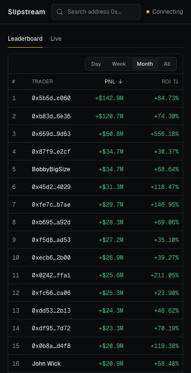
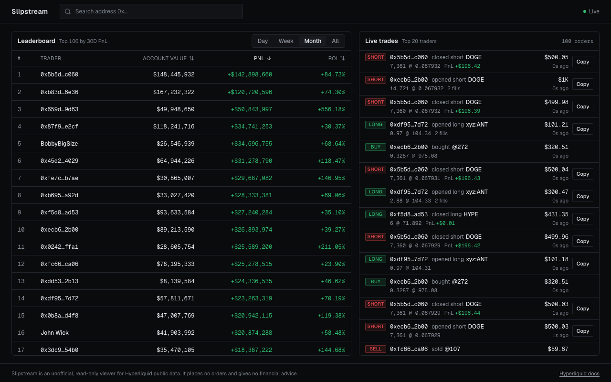
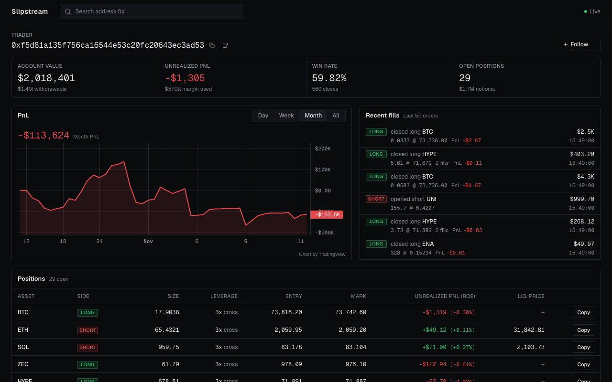
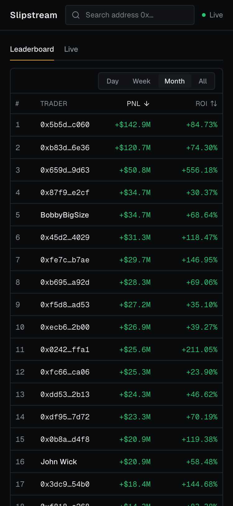
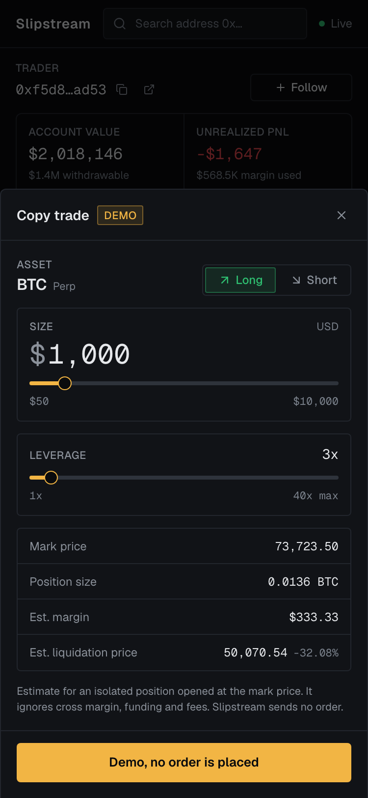
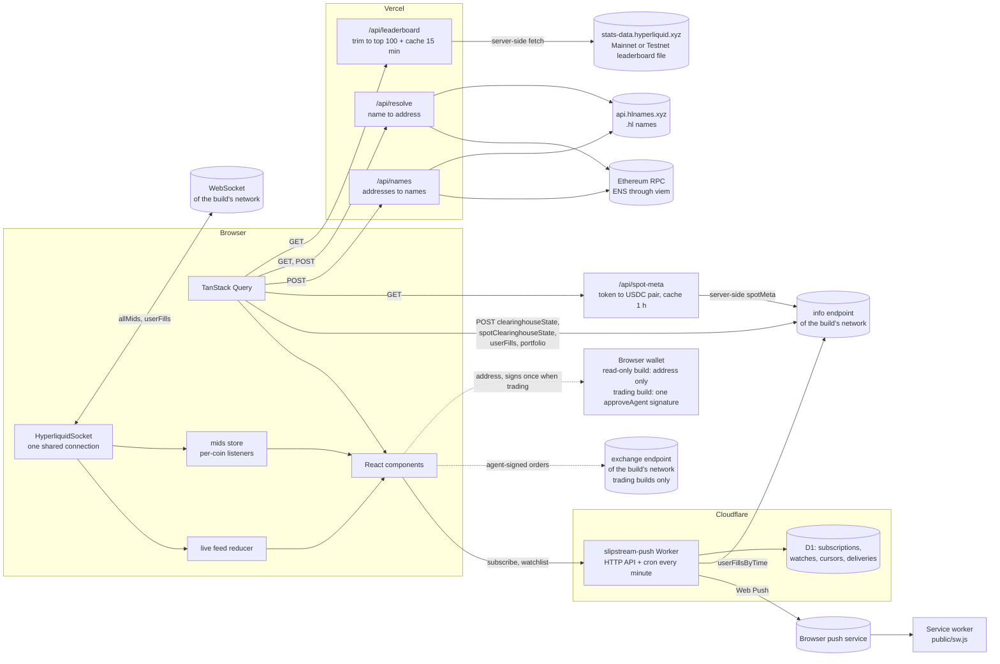

<picture>
  <source media="(prefers-color-scheme: dark)" srcset="public/brand/wordmark.svg">
  
</picture>

# Slipstream

Slipstream is a social feed for Hyperliquid perps traders. It shows the top 100 traders by 30-day PnL, a live feed of their orders, and a profile page for any address with open positions, a PnL chart and recent fills. The prices and the PnL update live from one shared WebSocket. A copy-trade sheet shows the margin and the liquidation price that a copy would need.

Each deployment can turn the same sheet into a real order ticket for its network. The mainnet host trades on **Hyperliquid mainnet with real funds**; the user enabled this on 2026-11-11 and accepts the risk. The testnet host trades on **Hyperliquid testnet** with test funds. Both use the same flow and the same safeguards: a risk acknowledgement on mainnet, a per-order size cap, a review step before every order, and a short-lived agent key (see [Trading](#trading)). A build without `NEXT_PUBLIC_TRADING_MODE` is read-only: the sheet is a demo, and nothing signs. The only server-side state is the store of push subscriptions for [push alerts](#push-alerts).

### One network per deployment

Each build has exactly one network. The mainnet host reads mainnet data. The testnet host reads testnet data everywhere: the leaderboard, the live feed, trader profiles, prices and explorer links. `NEXT_PUBLIC_NETWORK=testnet` selects testnet at build time. `NEXT_PUBLIC_TRADING_MODE=testnet` still selects testnet too. Without either variable, the build is mainnet. Trading is a separate switch: a build trades only when `NEXT_PUBLIC_TRADING_MODE` equals its network (`mainnet` on the mainnet host, `testnet` on the testnet host). All Hyperliquid endpoints come from `lib/network.ts`, and a test fails when an endpoint appears anywhere else in the app source.

**Live:**

- **Mainnet, with copy trading (real funds):** https://slipstream-hl.vercel.app
- **Testnet, with copy trading (test funds):** https://slipstream-testnet.vercel.app

The previous address, https://slipstream-alpha.vercel.app, still works. A link in the header switches between the two deployments (see [Deployments](#deployments)).

**Source:** https://github.com/lukicenturi/slipstream



| Home, desktop                                                  | Trader profile, desktop                               |
| -------------------------------------------------------------- | ----------------------------------------------------- |
|  |  |

| Home, mobile                                                             | Copy-trade sheet, mobile                                                            |
| ------------------------------------------------------------------------ | ----------------------------------------------------------------------------------- |
|  |  |

## Features

- **Leaderboard.** The top 100 traders by month PnL, with Day, Week, Month and All windows. Account value, PnL and ROI columns sort in both directions.
- **Live feed.** Orders of the top 20 traders arrive in real time. `/?view=live` opens the feed alone: on mobile as the row list (its own tab in the bottom bar), on desktop as a dense full-width table with Time, Trader, Action, Asset, Size @ Price, Notional and Closed PnL columns. `/` on desktop shows the leaderboard and the feed side by side. Partial fills of one order join into one row. The feed keeps at most 100 rows and drops duplicates after a reconnect.
- **Name search.** The header search accepts an address, an ENS name (`vitalik.eth`) or a Hyperliquid Names name (`testooor.hl`). The server resolves the name, and the search opens `/trader/<address>`. The search shows a clear message when a name has no address, when the lookup fails, and when the input is not valid.
- **Names instead of addresses.** The leaderboard, the live feed, the watching chips and the profile header show a name when one exists. The order is: the Hyperliquid display name, then the `.hl` primary name, then the ENS primary name, then the short address.
- **Trader profile.** Go to `/trader/<address>`. It shows account value, live unrealized PnL, win rate, open positions with a live mark price, balances, a PnL chart and the last 50 orders.
- **Balances across exchanges and spot.** The profile and the account page read the main perp exchange, every builder perp exchange that the address uses (for example `vntls` on testnet) and the spot account. "Account value" is the total of all of them, with a "Perps · Spot" line under it. See [Balances](#balances).
- **Tracking and alerts.** Star a trader on a leaderboard row or a feed row, or press "Follow" on the profile. `/watchlist` lists every tracked trader with account value, live unrealized PnL, open positions, the last trade, an alert switch and a remove button. Its form accepts an address, a `.eth` name or a `.hl` name. While a Slipstream tab is open, each new live order of a tracked trader becomes a notice: a toast, a row in the header bell, and (when you allow it) a browser notification. With push alerts on, a system notification arrives even when no tab is open. See [Tracking and alerts](#tracking-and-alerts) and [Push alerts](#push-alerts).
- **Wallet connect on both hosts.** Connect a wallet on either host. In a trading build it signs one agent approval; in a read-only build it only reads your address. The header shows "Connect wallet", then the short address and a blockie. In a trading build the popover shows the network badge, "USDC available", "Account value", a "My account" link and Disconnect. In a read-only build it shows the account value and the note "Read-only: Slipstream never asks for a signature on mainnet.". Slipstream never asks for your wallet key.
- **Account page.** `/account` shows the connected wallet's account on the network of the host: account value, withdrawable USDC ("USDC available" in a trading build), margin used, live unrealized PnL, positions, balances and fills, the explorer link, and an "Open on Mainnet" or "Open on Testnet" link to the same address on the other host. A trading build also shows the builder-USDC transfer note, and on testnet a faucet link when the wallet has no testnet funds. Without a wallet, the page says: "No wallet? Search any address in the header, or track it in the watchlist." It uses the same queries and the same socket as `/trader/<address>`, so both pages show the same numbers. The page only reads; it sends no exchange request.
- **Copy-trade sheet.** Each position row and each perp feed row has a "Copy" button. The sheet shows side, size, leverage, the estimated margin and the estimated liquidation price. In a read-only build the confirm button says "Demo, no order is placed"; it shows a toast and does nothing else.
- **Copy trade on mainnet and testnet (trading builds).** Connect a browser wallet, confirm the risks (mainnet, once per 30 days), approve a Slipstream agent once, set side, size and leverage, press "Review order", then "Place mainnet order" or "Place testnet order". The order is a market-like IOC order on the main perp exchange. See [Trading](#trading).
- **Manage your positions (trading builds).** Your own positions have a "Manage" button: close all or part, set a take profit and a stop loss (on-chain, reduce-only), or start a trailing stop that Slipstream moves in your favour while a tab is open. `/account` and your own profile list your open orders with Cancel. See [Manage a position](#manage-a-position).
- **Network switch.** A small pill in the header shows the network of this deployment (`MAINNET` in grey or `TESTNET` in amber) and links to the other deployment. It keeps the current page when the other deployment has it. The footer has the same link. In the testnet build, the leaderboard and feed subtitles also say "Testnet".
- **Navigation.** Desktop nav links (Leaderboard, Live, Watchlist, Account) in the header and a mobile bottom tab bar with the same four destinations. `Live` is active on `/?view=live` at every width.
- **Asset icons.** Coin names in the feed, the positions table, the fills list and the sheet have a 16 px icon (24 px in the sheet). Icons come from `app.hyperliquid.xyz/coins/<COIN>.svg`. A coin without an icon (other perp DEXs such as `xyz:NVDA`, spot ids such as `@107`, or a failed image) shows a 2-letter monogram in the same box, so rows keep their height.
- **Blockies identicons for every address, the same algorithm as MetaMask and Etherscan.** Each trader address in the leaderboard, the feed, the profile header, the watchlist, the watching chips, the bell, the account page and the wallet button has a small identicon. `lib/blockies.ts` implements the ethereum/blockies algorithm without a dependency, and `components/shared/Blockie.tsx` draws it as an inline SVG.

## Architecture



- `lib/network.ts` holds the network of the build (`NETWORK`), the endpoint table of both networks (`ENDPOINTS`) and the endpoints of this build (`HL`). The REST client, the socket, the leaderboard download and every explorer link read `HL`. `lib/network-guard.test.ts` fails when an endpoint URL appears in `app/`, `components/`, `hooks/` or `lib/` outside `lib/network.ts` and the exchange host pin.
- `lib/hyperliquid/schemas.ts` holds the zod schemas. They come from real responses in `fixtures/`. Every response goes through them. Numbers arrive as strings and become numbers in the schema layer, so components only see parsed types.
- `lib/hyperliquid/ws.ts` is the only place that opens a socket. It counts references per subscription, reconnects with exponential backoff and jitter, subscribes again after a reconnect, and sends a ping every 50 s.
- `lib/hyperliquid/mids.ts` keeps the mid prices from the shared socket. A listener subscribes to one coin, so a BTC tick re-renders only BTC rows. The testnet build fills the same store from the testnet socket, so the profile, the account page and the copy-trade sheet all use live testnet prices.
- `app/api/resolve` and `app/api/names` resolve names on the server. `GET /api/resolve?name=` returns `{ address, name, kind }`, or 404 for an unknown name, 400 for an input that is not a `.eth` or `.hl` name, and 502 when the provider fails. `POST /api/names` takes up to 120 addresses and returns their `.hl` and ENS primary names. The browser never calls the RPC or the HL Names API. `lib/names/` holds the resolvers (server-only), the zod schemas, a small in-memory cache and the browser client. `lib/names.ts` holds the pure helpers (search input detection, display name priority).
- `lib/calc/` holds the business logic as pure functions with Vitest tests: fill aggregation, the feed reducer, win rate, position PnL, chart series, leaderboard sort, and the liquidation estimate.
- `workers/push/` is the push Worker (a separate pnpm workspace package). It keeps the push subscriptions in Cloudflare D1, polls the tracked addresses once a minute and sends Web Push messages. `lib/push.ts` holds the pure app helpers, `hooks/usePushAlerts.ts` the browser calls, and `public/sw.js` shows the notifications. See [Push alerts](#push-alerts).
- `lib/trading/` holds the trading code for both networks. `config.ts` reads the mode, has the guard (`assertTradingEnabled`), the safeguard limits per network (`TRADING_LIMITS`) and the network switch link. `order.ts` builds orders, checks the size cap and reads order statuses. `agent.ts` stores the agent key. `settings.ts` holds the per-order cap. `riskAck.ts` holds the mainnet risk acknowledgement. `errors.ts` maps failures to short messages and keeps the exchange text. `exchange.ts` is the only module that calls the exchange endpoint, through `new HttpTransport({ isTestnet })` with a host pin per network. wagmi loads in its own lazy chunk in every build (about 72 KB raw, 23 KB gzip). The exchange SDK and the trading form load in separate chunks that only a trading build renders, so a read-only build never downloads them. `lib/wallet-guard.test.ts` fails when a wallet file that renders in a read-only build imports the exchange code.

## Stack

- Next.js 16 (App Router, Turbopack, Cache Components) and React 19
- TypeScript in strict mode
- TanStack Query 5 for REST calls; a small custom socket class for live data
- zod 4 at every API boundary
- viem 2 for ENS (server) and the agent key (trading builds)
- wagmi 3 for the browser wallet (every build, read-only without the trading flag) and `@nktkas/hyperliquid` 0.33 for signing (trading builds only)
- Tailwind CSS 4 and restyled shadcn/ui (Radix) components
- lightweight-charts 5 (TradingView) for the PnL chart
- sonner for toasts, lucide-react for icons
- Vitest 5 for unit tests
- Vercel for hosting
- Cloudflare Workers, Cron Triggers and D1 for push alerts; `@block65/webcrypto-web-push` for VAPID and payload encryption

## Design

- **Wordmark and icons.** The wordmark is the word `slipstream` in Geist Sans 600: `slip` in the text colour, `stream` in amber, with a thin amber bar under `stream`. The header draws it as live text (`components/layout/Wordmark.tsx`). `public/brand/` has outlined SVG copies for dark and light backgrounds and the `s` monogram. The favicon (`app/favicon.ico` with 16, 32 and 48 px layers, `app/icon.svg`), the Apple touch icon (`app/apple-icon.png`), the PWA icons and the push badge (`public/icons/`) all use the monogram. `app/opengraph-image.tsx` makes the 1200 x 630 social image.
- **Regenerate the brand assets.** The generators in `scripts/brand/` need `opentype.js`, `@fontsource/geist-sans` and `playwright`. They are not app dependencies. Install them in a scratch folder and point `BRAND_TOOLS` at it:

  ```bash
  mkdir -p /tmp/brand && cd /tmp/brand && npm init -y
  npm i opentype.js @fontsource/geist-sans playwright && npx playwright install chromium
  BRAND_TOOLS=/tmp/brand node <repo>/scripts/brand/make-wordmark.mjs   # SVGs
  BRAND_TOOLS=/tmp/brand node <repo>/scripts/brand/make-icons.mjs      # PNGs and the ICO
  ```

## Trade-offs

- **Server-side leaderboard trim and cache.** The leaderboard file is undocumented and about 39 MB on mainnet (about 45 MB and 55,000 rows on testnet). The server downloads the file of its own network, and both cache keys hold the network. The browser never downloads it. A route handler fetches it, keeps the top 100 rows by month PnL, and returns about 39 KB. The trimmed result has two cache layers: `unstable_cache` for 900 s and an in-memory copy with a 15 min TTL. If a refresh fails and older data exists, the route returns the older data with `stale: true`. If the shape changes and fewer than 10 rows parse, the route returns HTTP 502 and the UI shows an error with a retry button. The Day, Week and All tabs re-sort the same 100 rows, so a trader who is strong this week but not this month does not appear.
- **One socket with reference counts.** All `allMids` and `userFills` subscriptions share one connection. The first subscriber sends `subscribe` and the last one sends `unsubscribe`. The socket closes 5 s after the last subscriber leaves. After a reconnect, the snapshot replay could add old fills again. The feed reducer stops this with a set of seen `user:tid` keys and a per-trader time watermark.
- **Client-side info calls.** Per-wallet calls (`clearinghouseState`, `spotClearinghouseState`, `userNonFundingLedgerUpdates`, `userAbstraction`, `userFills`, `portfolio`) go from the browser straight to the info endpoint, which allows any origin. This keeps the server stateless and cheap. The cost: each visitor uses their own rate limit, and the server cannot cache these calls.
- **Liquidation estimate.** The sheet uses the isolated-margin formula: long `entry * (1 - 1/leverage + mmr)`, short `entry * (1 + 1/leverage - mmr)`. The maintenance margin rate is `1 / (2 * maxLeverage)` when the coin's max leverage is known, else 0.5%. It ignores cross margin, funding, fees and margin tiers. It is an approximation, not the exchange's number.
- **Fills carry no leverage.** The fill data has no leverage field, so feed rows do not show "5x". For a feed row, the sheet starts at 5x with a 20x limit. For a position row, it starts at the trader's leverage with the coin's max leverage.
- **The Mark column shows the mid.** The app has no mark price feed. It uses the `allMids` mid, which is within a few ticks of the mark. Live PnL and ROE use the same mid.
- **Names are best effort.** Names are an enhancement, not data that a view needs. The home page sends one `/api/names` request for the top 100 addresses and the followed traders. When a provider fails, the route returns the names of the other provider with `partial: true`. When the request fails, the rows show the display name or the short address, as before. The server caches each reverse result for 1 h, a found forward result for 24 h and an unknown name for 10 min, in memory per instance. A name change can therefore take up to 1 h to show. HL Names gets one bulk POST per 100 addresses. ENS uses viem multicall batching: 100 reverse lookups go out in 1 RPC request (about 850 ms cold, about 5 ms warm).
- **Trading behind a build flag.** Trading code runs only in a build whose `NEXT_PUBLIC_TRADING_MODE` equals its network. Each exchange function first calls a guard that throws otherwise, and the transport refuses any host other than the network's exchange host. The user's wallet signs once (approveAgent). After that a generated agent key signs orders, so the user does not see a wallet prompt per order. The cost: the agent key lives in `localStorage`, so anyone with access to this browser profile can trade this account until the agent expires (24 h on mainnet, 7 days on testnet) or the user revokes it. An agent cannot withdraw. On mainnet this is real money, so the per-order cap starts at $500 and every order goes through a review step.
- **One network per build.** A build reads the data of one network only. The network is a build-time value, so the server and the browser always agree, and one socket and one price store are enough. The cost: to look at the other network, open the other host (the pill in the header). The sheet reads the live mid from the shared socket. The account refreshes every 10 s while the sheet or the wallet popover is open, and the account page refreshes the account every 10 s and the fills every 30 s. Right before an order, the hook reads the mid once more over REST.
- **Push alerts poll once a minute.** In-tab alerts come from the shared socket and arrive in about a second. Push alerts come from a Cloudflare Worker that polls `userFillsByTime` for each tracked address once a minute, so a push can be up to a minute late. Vercel Hobby runs a cron only once a day, which is why the watcher runs on Cloudflare. The Worker keeps only what it needs to send a push (endpoint, network, addresses, threshold, optional labels) and no account.
- **Snapshots seed the feed.** The first `userFills` message after a subscribe is a snapshot. Its fills fill the feed on first load, without the slide-in animation. Only live fills animate.

## Accessibility and performance

- Every interactive element shows a 1 px accent outline with a 2 px offset on keyboard focus. Sortable headers are `<th scope="col">` with `aria-sort`. Long and short always have a text label next to the colour. The connection dot has a word next to it ("Live", "Reconnecting", "Offline").
- The sheet is a Radix dialog. It traps focus, closes on Escape, and sends focus back to the "Copy" button. Its sliders have `aria-label` and `aria-valuetext` ("5x", "$1,000"). Long and Short are native radio buttons.
- axe-core (WCAG 2.1 A and AA rules) reports 0 violations on the home page at 375 px and 1280 px, on the profile page, and on the profile page with the sheet open.
- `PositionRow`, `LeaderboardRow` and `FeedItem` use `React.memo`. Each row reads its own mid with `useMid`. A temporary render counter showed that every row commit on the profile page came from a change of that row's coin, and that the leaderboard rows did not commit at all during live ticks. The relative times ("12s ago") share one 10 s clock. Aggregation and sorting run in `useMemo`.

## Known limits

- A real fill is not tested on either network. It needs a funded wallet. The approval, the leverage call and the order call were tested against the real mainnet and testnet exchanges with an unfunded throwaway account, a stand-in agent and a fake browser wallet; the exchanges rejected them as expected (see DECISIONS.md).
- The `valid_until` unit (ms) in the agent name is not confirmed by a successful approval. If the exchange rejects the format, the sheet shows the exchange's exact text.
- Slipstream is unaudited. On mainnet, orders use real funds.
- WalletConnect needs a Reown project id and the optional package `@walletconnect/ethereum-provider` (not installed). Without them, only browser (injected) wallets connect.

- Not yet tested on a physical phone. The 375 px layout was checked in headless Chromium against the production URL (no horizontal scroll, sheet full width, toast shows).
- The win rate covers at most 2,000 fills, because `userFills` returns no more. For an active trader this is only the recent history.
- The leaderboard endpoint is undocumented. It can change or go away without notice.
- The feed follows the top 20 traders only. About 15 of them usually send a snapshot; the others have no recent fills.
- Spot fills show the raw market id (for example `@107`). Only the Balances panel loads spot metadata (the token map). Spot rows have no "Copy" button.
- On testnet (about 280 builder exchanges) the Balances panel reads only the builder exchanges that the address's fills or ledger name. An exchange that the address funded in another way does not show. Mainnet has 10, so it reads all of them.
- Spot tokens without a USDC pair show "—" and do not count in the total.
- The watchlist "Value" column is still the main perps account value. One row per trader with all exchanges and spot would cost up to 13 requests per row.
- Markets from other perp DEXs (for example `xyz:NVDA`) have no live mid in `allMids`. Their sheet shows the last fill price as the mark.
- The watchlist, the alert settings and the notices live in one browser. They do not sync across devices.
- Push alerts can be up to a minute late (one poll per minute). On Workers Free, one run polls at most 27 addresses; with more tracked addresses, each address gets a turn every few minutes. A push covers the first 50 tracked traders with alerts on.
- On iPhone and iPad, push alerts work only after "Add to Home Screen". A real phone test of push is still open.
- A cold `/api/leaderboard` request downloads the full file first. It takes about 7 s locally on both networks and can take longer on a cold serverless start.
- The `/dev` page (socket and feed diagnostics) is public but not linked.
- The profile header shows the Hyperliquid display name only when the leaderboard is already loaded in the tab (for example after a click on a leaderboard row). The page `<title>` keeps the short address, because names load in the browser.
- The default HL Names key is the public integration key from the provider's docs. It can have a rate limit. Set `HLNAMES_API_KEY` for a private key.

## What I'd build next

- An Expo app with the feed and the profile, sharing `lib/hyperliquid` and the hooks through a pnpm workspace.
- Real mark prices, funding and max leverage per coin from `metaAndAssetCtxs`, so the sheet and the Mark column use exchange data.
- The exchange's tiered maintenance margin table in the liquidation estimate.
- Token names for spot fills (the token map from `/api/spot-meta` already exists).
- Feed filters (coin, side, minimum size) and a "followed traders only" view.
- Playwright end-to-end tests in CI for the feed, the reconnect path and the sheet.

## Balances

Hyperliquid keeps the money of one address in several places. The Balances panel (profile and account page) shows all of them:

- **Perps.** The main perp exchange (`clearinghouseState`).
- **Builder perp exchanges.** HIP-3 exchanges such as `xyz` on mainnet or `vntls` on testnet. Each has its own margin account (`clearinghouseState` with `dex`). Their positions show in the positions table with a small badge (`vntls`). Their Copy button is off ("Builder exchange, not supported"), because the sheet places orders on the main exchange only.
- **Spot.** The token balances (`spotClearinghouseState`).

Which builder exchanges the app reads:

1. The app loads the list (`perpDexs`).
2. When the list has 20 entries or fewer (mainnet has 10), it reads every exchange.
3. Otherwise (testnet has about 280), it reads only the exchanges that the address's fills (`vntls:vOAI`) or its ledger transfers (`sourceDex` / `destinationDex` of a `send`) name.

How spot is priced: `/api/spot-meta` downloads `spotMeta` on the server, keeps a map from token to its USDC pair (`HARRR` -> `@1382`), and caches it for 1 h per network. The browser never downloads the raw file. The USD value is the token total times the live mid of the pair from the shared socket. USDC counts 1:1. A token without a USDC pair shows "—" and does not count. Until the socket sends the first mids, the account value says "Waiting for spot prices".

Unified accounts: in a unified or portfolio margin account (`userAbstraction`), the perps margin is part of the spot USDC balance. The total then counts spot only, the perp rows show their value in a muted colour, and the stat line says "Unified".

"Hide small" (on by default) hides rows below $1. A token without a price hides only when its total is 0. The switch is kept in `localStorage` (`slipstream.hideSmallBalances`).

Copy trading uses the main perps USDC only, on both networks. When it is 0 and a builder exchange holds USDC, the account page and the sheet say: "Your USDC is in vntls. Transfer it to Perps on Hyperliquid to trade here."

## Tracking and alerts

Track a trader in one of these ways:

1. Press the star on a leaderboard row or a feed row.
2. Press "Follow" on the trader profile.
3. Open `/watchlist` and enter an address, a `.eth` name or a `.hl` name.

A global tracker subscribes to every tracked trader through the one shared socket. A trader who is also in the home feed costs one subscription. Only fills that arrive live make a notice. The history that the socket sends first (the snapshot) never makes a notice.

For each new order of a tracked trader, Slipstream:

- adds a notice to the header bell (unread count, last 20 notices, "Mark all read");
- shows a toast with a "View" button. When more than 3 toasts would show within 5 s, one summary toast ("5 new trades from traders you follow") replaces them;
- shows a browser notification when you turned them on, the browser granted the permission, and the tab is hidden. A visible tab gets the toast only. A click on the notification opens the profile.
- with push alerts on, the Worker also sends a push. The in-tab notification and the push use the same tag (`network:user:oid`), so the system shows one notification when both arrive.

The bell's settings control toasts, browser notifications, push alerts and a minimum order size (Any, $1K, $10K, $100K). The watchlist page has an alert switch per trader.

What is stored, all in `localStorage` of this browser:

| Key                            | Value                                               |
| ------------------------------ | --------------------------------------------------- |
| `slipstream.watchlist`         | the tracked addresses (unchanged format)            |
| `slipstream.alerts`            | the global settings and the per-trader alert switch |
| `slipstream.notifications`     | the last 50 notices, newest first                   |
| `slipstream.push`              | whether push alerts are on, and the push endpoint   |
| `slipstream.hideSmallBalances` | the "Hide small" switch of the Balances panel       |

Trading builds add the agent key, the size cap and the mainnet risk acknowledgement (see [Trading](#trading)).

Limits: in-tab alerts fire only while a Slipstream tab is open; push alerts cover the rest (see below). Browser notifications and push alerts need your permission. The watchlist page loads account data for the first 50 traders; alerts work for all of them.

## Push alerts

Push alerts reach you when no Slipstream tab is open.

How it works:

1. Open the bell, then the settings, and turn on "Push alerts". The browser asks for the notification permission.
2. The app registers `public/sw.js`, subscribes to the browser push service with the VAPID public key, and sends the subscription, the network of the build, the tracked addresses with alerts on, their names and the minimum size to the Worker.
3. When the watchlist, a per-trader switch, the minimum size or a name changes, the app sends the new list again (after 1 s, only when it differs).
4. Once a minute, the Worker polls `userFillsByTime` for each tracked address, groups new fills by order, and sends one push per order above your minimum. More than 3 orders in one run become one summary push.
5. The service worker shows the notification. A click opens the trader profile (or the watchlist for a summary).

"Send test" asks the Worker for one test push. On iPhone and iPad, add Slipstream to the Home Screen first (Share, then Add to Home Screen); Safari supports push only for a Home Screen web app.

**The Worker.** `workers/push/` is a Cloudflare Worker with a D1 database, deployed at https://slipstream-push.rosarylock.workers.dev. A cron trigger runs the watcher every minute. A new address starts two minutes back, so a new watch never sends old trades. Each address has a cursor (the newest fill time and the trade ids at that time), so a fill is never sent twice. The Worker stays inside Workers Free: one run makes 3 D1 calls and at most 45 outgoing requests, and stops starting new work after 25 s; the cursor makes the next run continue.

**What is stored, and for how long.** Per browser: the push endpoint and its keys, the network, the watched addresses with an optional name, and the minimum size. The D1 store holds no account, no wallet and no IP address. Cloudflare Workers Logs keep the request logs of the Worker for 3 days. A delivery record (subscription and order id) is kept for 2 days to stop repeats. A cursor is removed when nobody watches its address. "Push alerts" off removes the subscription at once. When the push service says that a subscription is gone (404 or 410), the Worker removes it; after 10 other failures in a row, too.

**Run the Worker locally.**

```bash
cd workers/push
pnpm test                    # Vitest on the pure watcher logic
npx wrangler d1 migrations apply slipstream-push --local
npx wrangler dev             # http://localhost:8787, local D1
```

Put the four secrets in `workers/push/.dev.vars` (git-ignored) for local runs: `VAPID_PUBLIC_KEY`, `VAPID_PRIVATE_KEY`, `VAPID_SUBJECT` and `ADMIN_TOKEN`. `POST /tick` with `Authorization: Bearer <ADMIN_TOKEN>` runs the watcher once and returns its stats. Generate VAPID keys with `npx web-push generate-vapid-keys`. Deploy with `pnpm --filter slipstream-push-worker run deploy` (`run` is needed, because `pnpm deploy` is a built-in pnpm command).

**App variables.** Set both at build time. Without them, the switch says "Not set up on this deployment" and the app makes no request to the Worker. `.env.example` holds the production values.

| Variable                       | Use                              |
| ------------------------------ | -------------------------------- |
| `NEXT_PUBLIC_PUSH_API_URL`     | the Worker URL                   |
| `NEXT_PUBLIC_VAPID_PUBLIC_KEY` | the VAPID public key (base64url) |

## Trading

A trading build places real orders on the network of the build. The mainnet host (https://slipstream-hl.vercel.app) trades on **Hyperliquid mainnet with real funds**. The testnet host (https://slipstream-testnet.vercel.app) trades on **Hyperliquid testnet** with test funds. The user enabled mainnet trading on 2026-11-11 and accepts the risk. Only main-exchange perps can be ordered; builder perp exchanges (for example `xyz:NVDA`) cannot.

Enable it at build time (the value is inlined into the browser bundle). The mode must equal the build's network:

```bash
NEXT_PUBLIC_TRADING_MODE=mainnet pnpm dev -p 3100   # mainnet data, mainnet orders
NEXT_PUBLIC_TRADING_MODE=testnet pnpm dev -p 3100   # testnet data, testnet orders
```

`NEXT_PUBLIC_TRADING_MODE=testnet` also selects the testnet network. `NEXT_PUBLIC_NETWORK=testnet` alone makes a read-only testnet build. Any other combination (for example `NEXT_PUBLIC_NETWORK=testnet` with `NEXT_PUBLIC_TRADING_MODE=mainnet`) is read-only.

The sheet shows a **MAINNET** or **TESTNET** badge and three steps:

1. **Wallet.** Connect a browser wallet (for example MetaMask or Rabby). Slipstream never asks for your wallet key.
2. **Agent.** On mainnet, read the risk panel first, tick "I understand" and press "Continue". Then press "Approve agent" and sign once. The browser generates an agent key (a Hyperliquid API wallet). Your signature approves it for 24 h on mainnet or 7 days on testnet.
3. **Order.** Pick side, size and leverage. The sheet uses the live mid, your balance and the max leverage of the asset on the network. Press "Review order": the review card shows the network, the order, the size in coin and USD, the leverage, the worst fill price, the estimated margin and the estimated liquidation price. "Place mainnet order" or "Place testnet order" sets the leverage when needed and sends an IOC limit order 1 % through the mid. It is the only button that sends an order.

### Manage a position

Your own positions end with a **Manage** button instead of Copy: on `/account`, and on your own profile (`/trader/<your address>`) while that wallet is connected. The sheet shows the live position (size, entry, mid, unrealized PnL) and three tabs: **Close**, **TP / SL** and **Trailing**. Each tab has its own review and its own confirm button. Every order in this sheet is **reduce-only**: it can only shrink the position, never open or flip it.

- Each tab needs the same wallet, risk and agent steps as an order.
- The per-order size cap does not apply here: the cap limits new exposure, and these orders only remove it.
- Positions on builder perp exchanges show a disabled Manage button; manage them on Hyperliquid.

**Close.** Pick a share to close: 25 %, 50 %, 75 %, All, or any value on the slider. "Review close" shows the network, the order, the size, the worst fill price and the estimated realized PnL. "Close 50% on mainnet" (or "Close all on testnet") sends one reduce-only IOC order 1 % through the mid. A partial close must be at least $10. A full close of a smaller position is allowed.

**TP / SL.** Set a take profit, a stop loss, or both. Type a trigger price or use a quick level (take profit +5, +10, +25 or +50 % from the entry; stop loss −2, −5, −10 or −25 %; the signs flip for a short). The row shows the estimated PnL at the trigger and the current on-chain order with a Cancel button. An empty input leaves that side as it is.

- The orders are position TP/SL orders (`grouping: "positionTpsl"`): on-chain trigger orders for the whole position that follow its size.
- They trigger on the **mark price** and then send a market order with a **10 % slippage limit** (the same as Hyperliquid's own UI).
- A long's take profit must be above the current price and its stop loss below it; a short is the mirror. A trigger inside 0.1 % of the price is refused.
- A new take profit or stop loss replaces the current one. The new order goes out first. Only when the exchange accepts it is the old one cancelled, so the position is never without its stop. If that cancel fails, the sheet says "The old stop loss is still open; cancel it in Open orders."

**Trailing stop.** Pick a distance (1, 2, 5 or 10 %, or 0.5 to 50 %). "Start trailing stop" places an on-chain stop loss at that distance from the mid (reduce-only, market on trigger, 10 % slippage limit, `grouping: "normalTpsl"` with the position size). While a Slipstream tab is open on this device, Slipstream moves that stop with `modify` as the price moves your way: up for a long, down for a short. A real `modify` on a funded account is not yet verified, and the tab says so.

- The stop is on-chain. It protects the position when every tab is closed; it only stops moving.
- It moves only in your favour, never back. It moves at most every 15 s per coin and only by a step of at least 0.1 % of the price. Before each move, Slipstream reads your open orders once more: the new stop must also be better than the stop on the book, and on the right side of the current price (at least 0.1 % away).
- With more than one tab open, only one tab moves a stop at a time (a cross-tab lock per coin).
- Each `modify` carries `a: true`, which the exchange needs for a trigger order. With it, the order that a move replaced can stay open (when its cancel fails). Slipstream keeps the id of that one order, and the next open-orders check cancels exactly that order and says "Removed the old trailing stop order for BTC.". If that cancel fails, one toast says so, and the next check tries again; the stop does not move until the old order is gone. It never cancels any other order, also not a stop loss that you placed by hand.
- If a `modify` gets no answer (a network error), Slipstream keeps both prices until the next open-orders check shows which stop is on the book. If the book shows neither, the trailing ends. If a move waits for the book for more than 60 s, one toast says "The trailing stop for BTC is waiting for the order book and does not move.".
- The tab shows the current stop, the high-water mark, the distance, the last update, and "Active in this tab" or "Paused: open the app to resume".
- "Stop trailing (keep the stop)" leaves the stop where it is. "Stop and cancel the stop order" also cancels it. It reads your open orders first, so right after a move it cancels the moved stop (which can have a new order id) and the order that the move replaced, if that is still open. If the open orders cannot be read, it changes nothing and says "A move is settling, try again in a few seconds." right after a move, else "The open orders could not be read. Try again." The trailing ends only after the cancel succeeds. Both ask once more.
- When the stop order is gone (filled or cancelled), the trailing ends and a toast says so. This is also the message when the position and the stop are both gone (the stop most likely filled). When the position is closed but its stop is still on the book, the trailing ends with "the position is closed", and the stop order stays in Open orders for you to cancel.
- Only one trailing stop per coin: a second start says "A trailing stop for BTC already exists.". The TP / SL and Trailing buttons stay disabled with "Loading open orders." until your open orders load.
- "Close all" in the Close tab also ends the coin's trailing stop and cancels its stop order, and the result says so.
- An existing stop loss is replaced: the review lists it. The new stop goes out first, then the old one is cancelled. If that cancel fails, the status view says "The old stop loss is still open; cancel it in Open orders."

**Open orders.** `/account` and your own profile list your open orders on the main exchange: limit, take profit, stop loss and trailing stops, with side, size, price, a reduce-only badge and the time placed. Cancel an order with the cross button (it asks once more), or every order of a coin with "Cancel all BTC". The list refreshes every 10 s and right after each action. The "Trailing stop" label follows the stop after a move, also when the move gave it a new order id. When you cancel a trailing stop here, or replace it in the TP / SL tab, Slipstream reads your open orders again first. The same request then cancels the live stop (also when a move gave it a new order id) and the order that its last move left open, if there is one, and the trailing ends. The TP / SL review says "Ends the trailing stop". If the open orders cannot be read, nothing is sent and it says "The open orders could not be read. Try again.". If an extra cancel fails, one toast names the order that is still open.

### Safeguards

| Safeguard            | Mainnet                                                                                                                 | Testnet |
| -------------------- | ----------------------------------------------------------------------------------------------------------------------- | ------- |
| Risk acknowledgement | once, shown again after 30 days                                                                                         | none    |
| Review step          | before every order                                                                                                      | same    |
| Per-order size cap   | $500 by default                                                                                                         | $10,000 |
| Highest cap allowed  | $50,000                                                                                                                 | $50,000 |
| Agent key life       | 24 h                                                                                                                    | 7 days  |
| Worst fill price     | 1 % through the mid                                                                                                     | same    |
| TP / SL limit        | 10 % through the trigger                                                                                                | same    |
| Automatic actions    | only a favourable move of the trailing stop, at most every 15 s, and the cancel of the one order that the move replaced | same    |

The cap shows under the size ("Cap $500 per order · change"). "change" opens a small editor; the value is kept in this browser. The slider stops at the cap, or at balance x leverage when that is lower. The order hook also refuses a size above the cap.

### What the agent key can and cannot do

The agent can set leverage and place, modify and cancel orders for your account on the build's network. It cannot withdraw or transfer funds. It lives only in this browser's `localStorage`, so anyone with access to this browser profile can trade with it until it expires.

- "Forget agent" removes it from this browser.
- "Revoke on Hyperliquid" opens the API page of the network's app (https://app.hyperliquid.xyz/API or https://app.hyperliquid-testnet.xyz/API), where you can remove it on the exchange.
- The sheet shows the remaining time ("Agent key expires in 23 h").

The agent name is `slipstream valid_until <ms>`. The unit (ms) follows the other Hyperliquid timestamps, but no successful approval confirms it yet. When the exchange refuses an action, the sheet shows a short message and the exchange's exact text under it.

### What is stored

| Key                                     | Value                                                                                |
| --------------------------------------- | ------------------------------------------------------------------------------------ |
| `slipstream.agent.<network>.<owner>`    | the agent key, its address, name, creation and expiry time                           |
| `slipstream.trading.<network>`          | the per-order cap (`{ maxOrderUsd }`)                                                |
| `slipstream.mainnetRiskAck`             | the time of the mainnet risk acknowledgement (`{ at }`)                              |
| `slipstream.trailing.<network>.<owner>` | the trailing stops: coin, side, distance, stop oid and price, high-water mark, times |

An agent under the old key `slipstream.testnet.agent.<owner>` moves to the new key once.

Limits: the minimum order is $10. Sizes are rounded down to the asset's size decimals; prices to 5 significant figures. An asset that is not listed on the network cannot be ordered. Hyperliquid prunes an agent when the account has no funds.

### Manual test with a funded wallet

1. Start the app with one of the commands above and open a trader profile.
2. Connect your wallet in the header ("Connect wallet", then your wallet).
3. Fund the account: on testnet, get test USDC at https://app.hyperliquid-testnet.xyz/drip (the faucet needs a wallet that holds funds on mainnet); on mainnet, deposit on Hyperliquid.
4. Press "Copy" on a position row (BTC or ETH).
5. On mainnet, tick "I understand" and press "Continue".
6. Press "Approve agent" and sign in the wallet.
7. Set a size of at least $10 and press "Review order". Check the worst fill price, then press "Place mainnet order" or "Place testnet order".
8. Expect a toast such as "Filled 0.0136 BTC at 74,650.00 on testnet" and a result row with an explorer link. The Hyperliquid app shows the position.

## Deployments

Two Vercel projects build the same repository, https://github.com/lukicenturi/slipstream. Each project has a Git connection to it. One build-time variable makes the difference:

|                            | Mainnet                                 | Testnet                                                   |
| -------------------------- | --------------------------------------- | --------------------------------------------------------- |
| URL                        | https://slipstream-hl.vercel.app        | https://slipstream-testnet.vercel.app                     |
| `NEXT_PUBLIC_NETWORK`      | unset                                   | `testnet`                                                 |
| `NEXT_PUBLIC_TRADING_MODE` | `mainnet`                               | `testnet`                                                 |
| Copy-trade sheet           | real orders on Hyperliquid mainnet      | real orders on Hyperliquid testnet                        |
| Wallet                     | approves a 24 h agent once, then trades | approves a 7-day agent once, then trades                  |
| Safeguards                 | risk panel, $500 cap, review step       | $10,000 cap, review step                                  |
| Data                       | mainnet                                 | testnet: leaderboard, feed, profiles, prices and explorer |
| Header pill                | `MAINNET`, links to testnet             | `TESTNET` (amber), links to mainnet                       |

- **Network switch.** The pill in the header and a link in the footer open the other deployment. The link keeps the path for `/`, `/?view=live`, `/watchlist`, `/account` and `/trader/<address>`. Any other page links to the home page. It is a plain link between two hosts, as on app.hyperliquid.xyz and app.hyperliquid-testnet.xyz. The app never changes network at run time: the socket, the price store and `localStorage` belong to one host.
- **Host addresses.** `NEXT_PUBLIC_MAINNET_URL` and `NEXT_PUBLIC_TESTNET_URL` set the two addresses that the switch uses. Without them, the switch uses the two production addresses above. Set them at build time, for example to link two preview deployments.
- **Trading per build.** Each project sets `NEXT_PUBLIC_TRADING_MODE` to its own network. A build without it (a preview, local dev) is read-only: a wallet can connect, but the app only reads its address, never requests a signature, and its bundle does not load the exchange code.

## Local development

Requirements: Node 22 and pnpm 10.

```bash
pnpm install
pnpm dev            # http://localhost:3000
```

Checks (all three must pass; they also cover `workers/push`):

```bash
pnpm lint && pnpm typecheck && pnpm test
```

Other commands:

```bash
pnpm build          # production build
pnpm format         # Prettier
node scripts/capture-ws-fixtures.mjs   # capture the WebSocket fixtures again
```

## Environment

All variables are optional. Without them the app works as is, read-only, on mainnet.

| Variable                               | Default                                 | Use                                                                                                         |
| -------------------------------------- | --------------------------------------- | ----------------------------------------------------------------------------------------------------------- |
| `ETH_RPC_URL`                          | `https://ethereum-rpc.publicnode.com`   | Ethereum mainnet RPC for ENS lookups                                                                        |
| `HLNAMES_API_KEY`                      | the public integration key of HL Names  | `X-API-Key` header for `api.hlnames.xyz`                                                                    |
| `NEXT_PUBLIC_NETWORK`                  | unset (mainnet)                         | `testnet` makes a testnet build: testnet data everywhere. Alone it is read-only. Set it at build time.      |
| `NEXT_PUBLIC_TRADING_MODE`             | unset (read-only)                       | `mainnet` or `testnet` turns trading on when it equals the build's network; `testnet` also selects testnet. |
| `NEXT_PUBLIC_WALLETCONNECT_PROJECT_ID` | unset                                   | A Reown project id adds WalletConnect (both builds). Also run `pnpm add @walletconnect/ethereum-provider`.  |
| `NEXT_PUBLIC_MAINNET_URL`              | `https://slipstream-hl.vercel.app`      | The mainnet host that the network switch opens from the testnet build. Set it at build time.                |
| `NEXT_PUBLIC_TESTNET_URL`              | `https://slipstream-testnet.vercel.app` | The testnet host that the network switch opens from the mainnet build. Set it at build time.                |
| `NEXT_PUBLIC_PUSH_API_URL`             | unset (push alerts off)                 | The push Worker URL. Set it at build time, together with the VAPID key.                                     |
| `NEXT_PUBLIC_VAPID_PUBLIC_KEY`         | unset (push alerts off)                 | The VAPID public key of the push Worker. Set it at build time.                                              |

## Project layout

```
app/                 routes: home (?view=live for the feed alone), /trader/[address], /watchlist, /account, /api/leaderboard, /api/resolve, /api/names, /api/spot-meta, /dev
components/          layout, leaderboard, feed, trader, account, copy-trade, manage-position, trading, providers, shared, ui (restyled shadcn)
hooks/               data hooks (queries, socket, mids, feed, watchlist, alerts, notices)
lib/network.ts       the network of the build and every Hyperliquid endpoint
lib/hyperliquid/     schemas, REST client, socket, mids store, leaderboard trim
lib/names/           ENS and HL Names resolvers (server-only), schemas, cache, browser client
lib/calc/            pure business logic with tests
lib/trading/         trading on both networks: mode guard, limits, orders, TP/SL, trailing stop, open orders, agent key, size cap, risk ack, errors, exchange calls
lib/push.ts          push alert helpers (subscription body, availability, stored state)
public/              service worker (sw.js), PWA icons and push badge (icons/), outlined wordmark and monogram (brand/)
scripts/brand/       generators for the wordmark SVGs and the icon set (run from a scratch folder)
workers/push/        Cloudflare Worker: push API, D1 store, one-minute watcher
fixtures/            trimmed real API responses
docs/                README images
DECISIONS.md         every decision and deviation, with dates
```

## Disclaimer

Slipstream is unofficial, unaudited software. Trading uses your own funds at your own risk. A build without `NEXT_PUBLIC_TRADING_MODE` is a read-only viewer for Hyperliquid public data. Slipstream gives no financial advice and is not affiliated with Hyperliquid. See the [Hyperliquid docs](https://hyperliquid.gitbook.io/hyperliquid-docs) for the official API.
