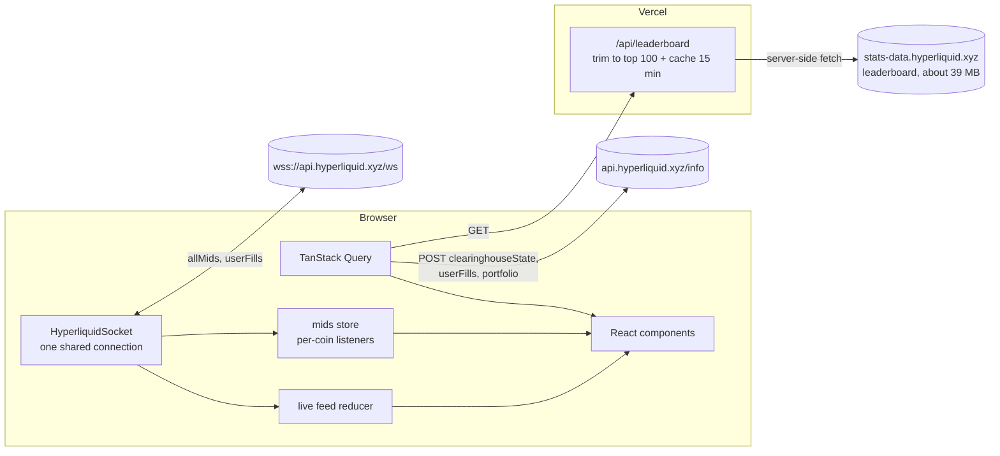

# Slipstream

Slipstream is a read-only social feed for Hyperliquid perps traders. It shows the top 100 traders by 30-day PnL, a live feed of their orders, and a profile page for any address with open positions, a PnL chart and recent fills. The prices and the PnL update live from one shared WebSocket. A demo copy-trade sheet shows the margin and the liquidation price that a copy would need. It places no order. Slipstream has no wallet connection, no signing and no database.

**Live:** https://slipstream-alpha.vercel.app


| Home, desktop                                                  | Trader profile, desktop                               |
| -------------------------------------------------------------- | ----------------------------------------------------- |
|  |  |

| Home, mobile                                                             | Copy-trade sheet, mobile                                                            |
| ------------------------------------------------------------------------ | ----------------------------------------------------------------------------------- |
|  |  |

## Features

- **Leaderboard.** The top 100 traders by month PnL, with Day, Week, Month and All windows. Account value, PnL and ROI columns sort in both directions.
- **Live feed.** Orders of the top 20 traders arrive in real time. Partial fills of one order join into one row. The feed keeps at most 100 rows and drops duplicates after a reconnect.
- **Trader profile.** Go to `/trader/<address>`. It shows account value, live unrealized PnL, win rate, open positions with a live mark price, a PnL chart and the last 50 orders.
- **Watchlist.** Follow a trader. The list stays in `localStorage`, and the home page shows the followed traders as chips.
- **Copy-trade sheet (demo).** Each position row and each perp feed row has a "Copy" button. The sheet shows side, size, leverage, the estimated margin and the estimated liquidation price. The confirm button says "Demo, no order is placed". It shows a toast and does nothing else.

## Architecture



- `lib/hyperliquid/schemas.ts` holds the zod schemas. They come from real responses in `fixtures/`. Every response goes through them. Numbers arrive as strings and become numbers in the schema layer, so components only see parsed types.
- `lib/hyperliquid/ws.ts` is the only place that opens a socket. It counts references per subscription, reconnects with exponential backoff and jitter, subscribes again after a reconnect, and sends a ping every 50 s.
- `lib/hyperliquid/mids.ts` keeps the mid prices. A listener subscribes to one coin, so a BTC tick re-renders only BTC rows.
- `lib/calc/` holds the business logic as pure functions with Vitest tests: fill aggregation, the feed reducer, win rate, position PnL, chart series, leaderboard sort, and the liquidation estimate.

## Stack

- Next.js 16 (App Router, Turbopack, Cache Components) and React 19
- TypeScript in strict mode
- TanStack Query 5 for REST calls; a small custom socket class for live data
- zod 4 at every API boundary
- Tailwind CSS 4 and restyled shadcn/ui (Radix) components
- lightweight-charts 5 (TradingView) for the PnL chart
- sonner for toasts, lucide-react for icons
- Vitest 5 for unit tests
- Vercel for hosting

## Trade-offs

- **Server-side leaderboard trim and cache.** The leaderboard file is undocumented and about 39 MB. The browser never downloads it. A route handler fetches it, keeps the top 100 rows by month PnL, and returns about 39 KB. The trimmed result has two cache layers: `unstable_cache` for 900 s and an in-memory copy with a 15 min TTL. If a refresh fails and older data exists, the route returns the older data with `stale: true`. If the shape changes and fewer than 10 rows parse, the route returns HTTP 502 and the UI shows an error with a retry button. The Day, Week and All tabs re-sort the same 100 rows, so a trader who is strong this week but not this month does not appear.
- **One socket with reference counts.** All `allMids` and `userFills` subscriptions share one connection. The first subscriber sends `subscribe` and the last one sends `unsubscribe`. The socket closes 5 s after the last subscriber leaves. After a reconnect, the snapshot replay could add old fills again. The feed reducer stops this with a set of seen `user:tid` keys and a per-trader time watermark.
- **Client-side info calls.** Per-wallet calls (`clearinghouseState`, `userFills`, `portfolio`) go from the browser straight to the info endpoint, which allows any origin. This keeps the server stateless and cheap. The cost: each visitor uses their own rate limit, and the server cannot cache these calls.
- **Liquidation estimate.** The sheet uses the isolated-margin formula: long `entry * (1 - 1/leverage + mmr)`, short `entry * (1 + 1/leverage - mmr)`. The maintenance margin rate is `1 / (2 * maxLeverage)` when the coin's max leverage is known, else 0.5%. It ignores cross margin, funding, fees and margin tiers. It is an approximation, not the exchange's number.
- **Fills carry no leverage.** The fill data has no leverage field, so feed rows do not show "5x". For a feed row, the sheet starts at 5x with a 20x limit. For a position row, it starts at the trader's leverage with the coin's max leverage.
- **The Mark column shows the mid.** The app has no mark price feed. It uses the `allMids` mid, which is within a few ticks of the mark. Live PnL and ROE use the same mid.
- **Snapshots seed the feed.** The first `userFills` message after a subscribe is a snapshot. Its fills fill the feed on first load, without the slide-in animation. Only live fills animate.

## Accessibility and performance

- Every interactive element shows a 1 px accent outline with a 2 px offset on keyboard focus. Sortable headers are `<th scope="col">` with `aria-sort`. Long and short always have a text label next to the colour. The connection dot has a word next to it ("Live", "Reconnecting", "Offline").
- The sheet is a Radix dialog. It traps focus, closes on Escape, and sends focus back to the "Copy" button. Its sliders have `aria-label` and `aria-valuetext` ("5x", "$1,000"). Long and Short are native radio buttons.
- axe-core (WCAG 2.1 A and AA rules) reports 0 violations on the home page at 375 px and 1280 px, on the profile page, and on the profile page with the sheet open.
- `PositionRow`, `LeaderboardRow` and `FeedItem` use `React.memo`. Each row reads its own mid with `useMid`. A temporary render counter showed that every row commit on the profile page came from a change of that row's coin, and that the leaderboard rows did not commit at all during live ticks. The relative times ("12s ago") share one 10 s clock. Aggregation and sorting run in `useMemo`.

## Known limits

- Not yet tested on a physical phone. The 375 px layout was checked in headless Chromium against the production URL (no horizontal scroll, sheet full width, toast shows).
- The win rate covers at most 2,000 fills, because `userFills` returns no more. For an active trader this is only the recent history.
- The leaderboard endpoint is undocumented. It can change or go away without notice.
- The feed follows the top 20 traders only. About 15 of them usually send a snapshot; the others have no recent fills.
- Spot fills show the raw market id (for example `@107`), because the app does not load spot metadata. Spot rows have no "Copy" button.
- Markets from other perp DEXs (for example `xyz:NVDA`) have no live mid in `allMids`. Their sheet shows the last fill price as the mark.
- The watchlist lives in one browser. It does not sync across devices.
- A cold `/api/leaderboard` request downloads the full file first. It takes about 7 s locally and can take longer on a cold serverless start.
- The `/dev` page (socket and feed diagnostics) is public but not linked.

## What I'd build next

- An Expo app with the feed and the profile, sharing `lib/hyperliquid` and the hooks through a pnpm workspace.
- Real mark prices, funding and max leverage per coin from `metaAndAssetCtxs`, so the sheet and the Mark column use exchange data.
- The exchange's tiered maintenance margin table in the liquidation estimate.
- Spot metadata, so spot rows show token names.
- Feed filters (coin, side, minimum size) and a "followed traders only" view.
- Playwright end-to-end tests in CI for the feed, the reconnect path and the sheet.

## Local development

Requirements: Node 22 and pnpm 10.

```bash
pnpm install
pnpm dev            # http://localhost:3000
```

Checks (all three must pass):

```bash
pnpm lint && pnpm typecheck && pnpm test
```

Other commands:

```bash
pnpm build          # production build
pnpm format         # Prettier
node scripts/capture-ws-fixtures.mjs   # capture the WebSocket fixtures again
```

No environment variables are needed.

## Project layout

```
app/                 routes: home, /trader/[address], /api/leaderboard, /dev
components/          layout, leaderboard, feed, trader, copy-trade, shared, ui (restyled shadcn)
hooks/               data hooks (queries, socket, mids, feed, watchlist)
lib/hyperliquid/     schemas, REST client, socket, mids store, leaderboard trim
lib/calc/            pure business logic with tests
fixtures/            trimmed real API responses
docs/                README images
DECISIONS.md         every decision and deviation, with dates
```

## Disclaimer

Slipstream is an unofficial, read-only viewer for Hyperliquid public data. It places no orders and gives no financial advice. It is not affiliated with Hyperliquid. See the [Hyperliquid docs](https://hyperliquid.gitbook.io/hyperliquid-docs) for the official API.
