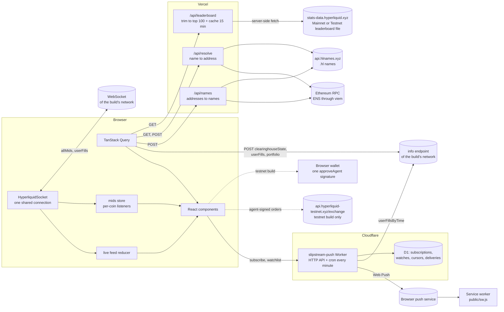

# Slipstream

Slipstream is a social feed for Hyperliquid perps traders. It shows the top 100 traders by 30-day PnL, a live feed of their orders, and a profile page for any address with open positions, a PnL chart and recent fills. The prices and the PnL update live from one shared WebSocket. A copy-trade sheet shows the margin and the liquidation price that a copy would need.

The mainnet deployment is read-only: the sheet is a demo, and there is no wallet connection and no signing. The only server-side state is the store of push subscriptions for [push alerts](#push-alerts). A second deployment, built with `NEXT_PUBLIC_NETWORK=testnet`, reads Hyperliquid testnet data and turns the same sheet into a real order ticket for **Hyperliquid testnet** (see [One network per deployment](#one-network-per-deployment) and [Testnet trading](#testnet-trading)). No build can trade on mainnet.

### One network per deployment

Each build has exactly one network. The mainnet host reads mainnet data and is read-only. The testnet host reads testnet data everywhere: the leaderboard, the live feed, trader profiles, prices and explorer links. It can also place testnet orders. `NEXT_PUBLIC_NETWORK=testnet` selects testnet at build time. `NEXT_PUBLIC_TRADING_MODE=testnet` still selects testnet too. Without either variable, the build is mainnet. All Hyperliquid endpoints come from `lib/network.ts`, and a test fails when an endpoint appears anywhere else in the app source.

**Live:**

- **Mainnet, read-only:** https://slipstream-hl.vercel.app
- **Testnet, with copy trading:** https://slipstream-testnet.vercel.app

The previous address, https://slipstream-alpha.vercel.app, still works. A link in the header switches between the two deployments (see [Deployments](#deployments)).

**Source:** https://github.com/lukicenturi/slipstream


| Home, desktop                                                  | Trader profile, desktop                               |
| -------------------------------------------------------------- | ----------------------------------------------------- |
|  |  |

| Home, mobile                                                             | Copy-trade sheet, mobile                                                            |
| ------------------------------------------------------------------------ | ----------------------------------------------------------------------------------- |
|  |  |

## Features

- **Leaderboard.** The top 100 traders by month PnL, with Day, Week, Month and All windows. Account value, PnL and ROI columns sort in both directions.
- **Live feed.** Orders of the top 20 traders arrive in real time. `/?view=live` opens the feed alone: on mobile as the row list (its own tab in the bottom bar), on desktop as a dense full-width table with Time, Trader, Action, Asset, Size @ Price, Notional and Closed PnL columns. `/` on desktop shows the leaderboard and the feed side by side. Partial fills of one order join into one row. The feed keeps at most 100 rows and drops duplicates after a reconnect.
- **Name search.** The header search accepts an address, an ENS name (`vitalik.eth`) or a Hyperliquid Names name (`testooor.hl`). The server resolves the name, and the search opens `/trader/<address>`. The search shows a clear message when a name has no address, when the lookup fails, and when the input is not valid.
- **Names instead of addresses.** The leaderboard, the live feed, the watching chips and the profile header show a name when one exists. The order is: the Hyperliquid display name, then the `.hl` primary name, then the ENS primary name, then the short address.
- **Trader profile.** Go to `/trader/<address>`. It shows account value, live unrealized PnL, win rate, open positions with a live mark price, a PnL chart and the last 50 orders.
- **Tracking and alerts.** Star a trader on a leaderboard row or a feed row, or press "Follow" on the profile. `/watchlist` lists every tracked trader with account value, live unrealized PnL, open positions, the last trade, an alert switch and a remove button. Its form accepts an address, a `.eth` name or a `.hl` name. While a Slipstream tab is open, each new live order of a tracked trader becomes a notice: a toast, a row in the header bell, and (when you allow it) a browser notification. With push alerts on, a system notification arrives even when no tab is open. See [Tracking and alerts](#tracking-and-alerts) and [Push alerts](#push-alerts).
- **Account page.** `/account` has a "My address" section: save an address, a `.eth` name or a `.hl` name once, and the page shows that trader profile on the network of the build. "Change" and "Forget" edit it. The value stays in this browser (`slipstream.myAddress`). In the testnet build, the page first shows the connected wallet's testnet account: account value, USDC available, margin used, live unrealized PnL, positions and fills, the testnet explorer link, an "Open on Mainnet" link to the same address on the mainnet host, and a faucet link when the wallet has no testnet funds. It uses the same queries and the same socket as `/trader/<address>`, so both pages show the same numbers. The page only reads; it sends no exchange request.
- **Copy-trade sheet (demo).** Each position row and each perp feed row has a "Copy" button. The sheet shows side, size, leverage, the estimated margin and the estimated liquidation price. The confirm button says "Demo, no order is placed". It shows a toast and does nothing else.
- **Testnet copy trade (testnet build only).** Connect a browser wallet, approve a Slipstream agent once, then place a market-like IOC order on Hyperliquid testnet from the same sheet. The wallet popover in the header shows "USDC available", "Account value" and a "My account" link.
- **Network switch.** A small pill in the header shows the network of this deployment (`MAINNET` in grey or `TESTNET` in amber) and links to the other deployment. It keeps the current page when the other deployment has it. The footer has the same link. In the testnet build, the leaderboard and feed subtitles also say "Testnet".
- **Navigation.** Desktop nav links (Leaderboard, Live, Watchlist, Account) in the header and a mobile bottom tab bar with the same four destinations. `Live` is active on `/?view=live` at every width.
- **Asset icons.** Coin names in the feed, the positions table, the fills list and the sheet have a 16 px icon (24 px in the sheet). Icons come from `app.hyperliquid.xyz/coins/<COIN>.svg`. A coin without an icon (other perp DEXs such as `xyz:NVDA`, spot ids such as `@107`, or a failed image) shows a 2-letter monogram in the same box, so rows keep their height.

## Architecture



- `lib/network.ts` holds the network of the build (`NETWORK`), the endpoint table of both networks (`ENDPOINTS`) and the endpoints of this build (`HL`). The REST client, the socket, the leaderboard download and every explorer link read `HL`. `lib/network-guard.test.ts` fails when an endpoint URL appears in `app/`, `components/`, `hooks/` or `lib/` outside `lib/network.ts` and the exchange host pin.
- `lib/hyperliquid/schemas.ts` holds the zod schemas. They come from real responses in `fixtures/`. Every response goes through them. Numbers arrive as strings and become numbers in the schema layer, so components only see parsed types.
- `lib/hyperliquid/ws.ts` is the only place that opens a socket. It counts references per subscription, reconnects with exponential backoff and jitter, subscribes again after a reconnect, and sends a ping every 50 s.
- `lib/hyperliquid/mids.ts` keeps the mid prices from the shared socket. A listener subscribes to one coin, so a BTC tick re-renders only BTC rows. The testnet build fills the same store from the testnet socket, so the profile, the account page and the copy-trade sheet all use live testnet prices.
- `app/api/resolve` and `app/api/names` resolve names on the server. `GET /api/resolve?name=` returns `{ address, name, kind }`, or 404 for an unknown name, 400 for an input that is not a `.eth` or `.hl` name, and 502 when the provider fails. `POST /api/names` takes up to 120 addresses and returns their `.hl` and ENS primary names. The browser never calls the RPC or the HL Names API. `lib/names/` holds the resolvers (server-only), the zod schemas, a small in-memory cache and the browser client. `lib/names.ts` holds the pure helpers (search input detection, display name priority).
- `lib/calc/` holds the business logic as pure functions with Vitest tests: fill aggregation, the feed reducer, win rate, position PnL, chart series, leaderboard sort, and the liquidation estimate.
- `workers/push/` is the push Worker (a separate pnpm workspace package). It keeps the push subscriptions in Cloudflare D1, polls the tracked addresses once a minute and sends Web Push messages. `lib/push.ts` holds the pure app helpers, `hooks/usePushAlerts.ts` the browser calls, and `public/sw.js` shows the notifications. See [Push alerts](#push-alerts).
- `lib/trading/` holds the testnet trading code. `config.ts` reads the mode, has the guard, and builds the network switch link. `order.ts` builds orders and reads order statuses. `agent.ts` stores the agent key. `errors.ts` maps failures to short messages. `exchange.ts` is the only module that calls the exchange endpoint, and only through `new HttpTransport({ isTestnet: true })`. The wallet code, wagmi and the SDK load in separate chunks, so the read-only build never downloads them.

## Stack

- Next.js 16 (App Router, Turbopack, Cache Components) and React 19
- TypeScript in strict mode
- TanStack Query 5 for REST calls; a small custom socket class for live data
- zod 4 at every API boundary
- viem 2 for ENS (server) and the agent key (testnet build)
- wagmi 3 for the browser wallet and `@nktkas/hyperliquid` 0.33 for testnet signing (testnet build only)
- Tailwind CSS 4 and restyled shadcn/ui (Radix) components
- lightweight-charts 5 (TradingView) for the PnL chart
- sonner for toasts, lucide-react for icons
- Vitest 5 for unit tests
- Vercel for hosting
- Cloudflare Workers, Cron Triggers and D1 for push alerts; `@block65/webcrypto-web-push` for VAPID and payload encryption

## Trade-offs

- **Server-side leaderboard trim and cache.** The leaderboard file is undocumented and about 39 MB on mainnet (about 45 MB and 55,000 rows on testnet). The server downloads the file of its own network, and both cache keys hold the network. The browser never downloads it. A route handler fetches it, keeps the top 100 rows by month PnL, and returns about 39 KB. The trimmed result has two cache layers: `unstable_cache` for 900 s and an in-memory copy with a 15 min TTL. If a refresh fails and older data exists, the route returns the older data with `stale: true`. If the shape changes and fewer than 10 rows parse, the route returns HTTP 502 and the UI shows an error with a retry button. The Day, Week and All tabs re-sort the same 100 rows, so a trader who is strong this week but not this month does not appear.
- **One socket with reference counts.** All `allMids` and `userFills` subscriptions share one connection. The first subscriber sends `subscribe` and the last one sends `unsubscribe`. The socket closes 5 s after the last subscriber leaves. After a reconnect, the snapshot replay could add old fills again. The feed reducer stops this with a set of seen `user:tid` keys and a per-trader time watermark.
- **Client-side info calls.** Per-wallet calls (`clearinghouseState`, `userFills`, `portfolio`) go from the browser straight to the info endpoint, which allows any origin. This keeps the server stateless and cheap. The cost: each visitor uses their own rate limit, and the server cannot cache these calls.
- **Liquidation estimate.** The sheet uses the isolated-margin formula: long `entry * (1 - 1/leverage + mmr)`, short `entry * (1 + 1/leverage - mmr)`. The maintenance margin rate is `1 / (2 * maxLeverage)` when the coin's max leverage is known, else 0.5%. It ignores cross margin, funding, fees and margin tiers. It is an approximation, not the exchange's number.
- **Fills carry no leverage.** The fill data has no leverage field, so feed rows do not show "5x". For a feed row, the sheet starts at 5x with a 20x limit. For a position row, it starts at the trader's leverage with the coin's max leverage.
- **The Mark column shows the mid.** The app has no mark price feed. It uses the `allMids` mid, which is within a few ticks of the mark. Live PnL and ROE use the same mid.
- **Names are best effort.** Names are an enhancement, not data that a view needs. The home page sends one `/api/names` request for the top 100 addresses and the followed traders. When a provider fails, the route returns the names of the other provider with `partial: true`. When the request fails, the rows show the display name or the short address, as before. The server caches each reverse result for 1 h, a found forward result for 24 h and an unknown name for 10 min, in memory per instance. A name change can therefore take up to 1 h to show. HL Names gets one bulk POST per 100 addresses. ENS uses viem multicall batching: 100 reverse lookups go out in 1 RPC request (about 850 ms cold, about 5 ms warm).
- **Testnet trading behind a build flag.** Trading code exists in the repository but runs only in a build with `NEXT_PUBLIC_TRADING_MODE=testnet`. Each exchange function first calls a guard that throws unless the mode is exactly `testnet`, and the transport refuses any host other than `api.hyperliquid-testnet.xyz`. The user's wallet signs once (approveAgent). After that a generated agent key signs orders, so the user does not see a wallet prompt per order. The cost: the agent key lives in `localStorage`, so anyone with access to this browser profile can trade this testnet account until the agent expires (30 days) or the user forgets or deregisters it. An agent cannot withdraw.
- **One network per build.** A build reads the data of one network only. The network is a build-time value, so the server and the browser always agree, and one socket and one price store are enough. The cost: to look at the other network, open the other host (the pill in the header). The sheet reads the live mid from the shared socket. The account refreshes every 10 s while the sheet or the wallet popover is open, and the account page refreshes the account every 10 s and the fills every 30 s. Right before an order, the hook reads the mid once more over REST.
- **Push alerts poll once a minute.** In-tab alerts come from the shared socket and arrive in about a second. Push alerts come from a Cloudflare Worker that polls `userFillsByTime` for each tracked address once a minute, so a push can be up to a minute late. Vercel Hobby runs a cron only once a day, which is why the watcher runs on Cloudflare. The Worker keeps only what it needs to send a push (endpoint, network, addresses, threshold, optional labels) and no account.
- **Snapshots seed the feed.** The first `userFills` message after a subscribe is a snapshot. Its fills fill the feed on first load, without the slide-in animation. Only live fills animate.

## Accessibility and performance

- Every interactive element shows a 1 px accent outline with a 2 px offset on keyboard focus. Sortable headers are `<th scope="col">` with `aria-sort`. Long and short always have a text label next to the colour. The connection dot has a word next to it ("Live", "Reconnecting", "Offline").
- The sheet is a Radix dialog. It traps focus, closes on Escape, and sends focus back to the "Copy" button. Its sliders have `aria-label` and `aria-valuetext` ("5x", "$1,000"). Long and Short are native radio buttons.
- axe-core (WCAG 2.1 A and AA rules) reports 0 violations on the home page at 375 px and 1280 px, on the profile page, and on the profile page with the sheet open.
- `PositionRow`, `LeaderboardRow` and `FeedItem` use `React.memo`. Each row reads its own mid with `useMid`. A temporary render counter showed that every row commit on the profile page came from a change of that row's coin, and that the leaderboard rows did not commit at all during live ticks. The relative times ("12s ago") share one 10 s clock. Aggregation and sorting run in `useMemo`.

## Known limits

- A real fill on testnet is not tested. It needs a wallet with testnet USDC. The approval, the leverage call and the order call were tested against the real testnet with an unfunded throwaway account and a fake browser wallet; the testnet rejected them as expected (see DECISIONS.md).
- WalletConnect needs a Reown project id and the optional package `@walletconnect/ethereum-provider` (not installed). Without them, only browser (injected) wallets connect.

- Not yet tested on a physical phone. The 375 px layout was checked in headless Chromium against the production URL (no horizontal scroll, sheet full width, toast shows).
- The win rate covers at most 2,000 fills, because `userFills` returns no more. For an active trader this is only the recent history.
- The leaderboard endpoint is undocumented. It can change or go away without notice.
- The feed follows the top 20 traders only. About 15 of them usually send a snapshot; the others have no recent fills.
- Spot fills show the raw market id (for example `@107`), because the app does not load spot metadata. Spot rows have no "Copy" button.
- Markets from other perp DEXs (for example `xyz:NVDA`) have no live mid in `allMids`. Their sheet shows the last fill price as the mark.
- The watchlist, the alert settings, the notices and the saved "My address" live in one browser. They do not sync across devices.
- Push alerts can be up to a minute late (one poll per minute). On Workers Free, one run polls at most 27 addresses; with more tracked addresses, each address gets a turn every few minutes. A push covers the first 50 tracked traders with alerts on.
- On iPhone and iPad, push alerts work only after "Add to Home Screen". A real phone test of push is still open.
- A cold `/api/leaderboard` request downloads the full file first. It takes about 7 s locally on both networks and can take longer on a cold serverless start.
- The `/dev` page (socket and feed diagnostics) is public but not linked.
- The profile header shows the Hyperliquid display name only when the leaderboard is already loaded in the tab (for example after a click on a leaderboard row). The page `<title>` keeps the short address, because names load in the browser.
- The default HL Names key is the public integration key from the provider's docs. It can have a rate limit. Set `HLNAMES_API_KEY` for a private key.

## What I'd build next

- An Expo app with the feed and the profile, sharing `lib/hyperliquid` and the hooks through a pnpm workspace.
- Real mark prices, funding and max leverage per coin from `metaAndAssetCtxs`, so the sheet and the Mark column use exchange data.
- The exchange's tiered maintenance margin table in the liquidation estimate.
- Spot metadata, so spot rows show token names.
- Feed filters (coin, side, minimum size) and a "followed traders only" view.
- Playwright end-to-end tests in CI for the feed, the reconnect path and the sheet.

## Tracking and alerts

Track a trader in one of these ways:

1. Press the star on a leaderboard row or a feed row.
2. Press "Follow" on the trader profile.
3. Open `/watchlist` and enter an address, a `.eth` name or a `.hl` name.

A global tracker subscribes to every tracked trader through the one shared socket. A trader who is also in the home feed costs one subscription. Only fills that arrive live make a notice. The history that the socket sends first (the snapshot) never makes a notice.

For each new order of a tracked trader, Slipstream:

- adds a notice to the header bell (unread count, last 20 notices, "Mark all read");
- shows a toast with a "View" button. When more than 3 toasts would show within 5 s, one summary toast ("5 new trades from traders you follow") replaces them;
- shows a browser notification when you turned them on, the browser granted the permission, and the tab is hidden. A visible tab gets the toast only. A click on the notification opens the profile.
- with push alerts on, the Worker also sends a push. The in-tab notification and the push use the same tag (`network:user:oid`), so the system shows one notification when both arrive.

The bell's settings control toasts, browser notifications, push alerts and a minimum order size (Any, $1K, $10K, $100K). The watchlist page has an alert switch per trader.

What is stored, all in `localStorage` of this browser:

| Key                        | Value                                               |
| -------------------------- | --------------------------------------------------- |
| `slipstream.watchlist`     | the tracked addresses (unchanged format)            |
| `slipstream.alerts`        | the global settings and the per-trader alert switch |
| `slipstream.notifications` | the last 50 notices, newest first                   |
| `slipstream.myAddress`     | the saved "My address" of the account page          |
| `slipstream.push`          | whether push alerts are on, and the push endpoint   |

Limits: in-tab alerts fire only while a Slipstream tab is open; push alerts cover the rest (see below). Browser notifications and push alerts need your permission. The watchlist page loads account data for the first 50 traders; alerts work for all of them.

## Push alerts

Push alerts reach you when no Slipstream tab is open.

How it works:

1. Open the bell, then the settings, and turn on "Push alerts". The browser asks for the notification permission.
2. The app registers `public/sw.js`, subscribes to the browser push service with the VAPID public key, and sends the subscription, the network of the build, the tracked addresses with alerts on, their names and the minimum size to the Worker.
3. When the watchlist, a per-trader switch, the minimum size or a name changes, the app sends the new list again (after 1 s, only when it differs).
4. Once a minute, the Worker polls `userFillsByTime` for each tracked address, groups new fills by order, and sends one push per order above your minimum. More than 3 orders in one run become one summary push.
5. The service worker shows the notification. A click opens the trader profile (or the watchlist for a summary).

"Send test" asks the Worker for one test push. On iPhone and iPad, add Slipstream to the Home Screen first (Share, then Add to Home Screen); Safari supports push only for a Home Screen web app.

**The Worker.** `workers/push/` is a Cloudflare Worker with a D1 database, deployed at https://slipstream-push.rosarylock.workers.dev. A cron trigger runs the watcher every minute. A new address starts two minutes back, so a new watch never sends old trades. Each address has a cursor (the newest fill time and the trade ids at that time), so a fill is never sent twice. The Worker stays inside Workers Free: one run makes 3 D1 calls and at most 45 outgoing requests, and stops starting new work after 25 s; the cursor makes the next run continue.

**What is stored, and for how long.** Per browser: the push endpoint and its keys, the network, the watched addresses with an optional name, and the minimum size. The D1 store holds no account, no wallet and no IP address. Cloudflare Workers Logs keep the request logs of the Worker for 3 days. A delivery record (subscription and order id) is kept for 2 days to stop repeats. A cursor is removed when nobody watches its address. "Push alerts" off removes the subscription at once. When the push service says that a subscription is gone (404 or 410), the Worker removes it; after 10 other failures in a row, too.

**Run the Worker locally.**

```bash
cd workers/push
pnpm test                    # Vitest on the pure watcher logic
npx wrangler d1 migrations apply slipstream-push --local
npx wrangler dev             # http://localhost:8787, local D1
```

Put the four secrets in `workers/push/.dev.vars` (git-ignored) for local runs: `VAPID_PUBLIC_KEY`, `VAPID_PRIVATE_KEY`, `VAPID_SUBJECT` and `ADMIN_TOKEN`. `POST /tick` with `Authorization: Bearer <ADMIN_TOKEN>` runs the watcher once and returns its stats. Generate VAPID keys with `npx web-push generate-vapid-keys`. Deploy with `pnpm --filter slipstream-push-worker run deploy` (`run` is needed, because `pnpm deploy` is a built-in pnpm command).

**App variables.** Set both at build time. Without them, the switch says "Not set up on this deployment" and the app makes no request to the Worker. `.env.example` holds the production values.

| Variable                       | Use                              |
| ------------------------------ | -------------------------------- |
| `NEXT_PUBLIC_PUSH_API_URL`     | the Worker URL                   |
| `NEXT_PUBLIC_VAPID_PUBLIC_KEY` | the VAPID public key (base64url) |

## Testnet trading

This mode places real orders on **Hyperliquid testnet**, with test funds. The mainnet deployment does not include it. The testnet deployment at https://slipstream-testnet.vercel.app has it on.

Enable it at build time (the value is inlined into the browser bundle):

```bash
NEXT_PUBLIC_NETWORK=testnet pnpm dev -p 3100
```

`NEXT_PUBLIC_TRADING_MODE=testnet` works the same way. The whole build then reads testnet data. Your own profile at `/trader/<your address>` on the testnet host shows your testnet account, with the same numbers as `/account`.

The sheet then shows a **Testnet** badge and three steps:

1. **Wallet.** Connect a browser wallet (for example MetaMask or Rabby). Slipstream never asks for your wallet key.
2. **Agent.** Press "Approve agent" and sign once. The browser generates an agent key (a Hyperliquid API wallet). Your signature approves it on testnet for 30 days. The agent can trade but cannot withdraw.
3. **Order.** Pick side, size and leverage. The sheet uses the live testnet mid, your testnet balance and the testnet max leverage of the asset. "Place testnet order" sets the leverage when needed and sends an IOC limit order 1 % through the mid.

What is stored: only the agent key, in `localStorage` under `slipstream.testnet.agent.<your address>`. "Forget agent" removes it from this browser. To deregister it on the exchange, use the API page of the testnet app (https://app.hyperliquid-testnet.xyz/API).

Limits: the minimum order is $10. Sizes are rounded down to the asset's size decimals; prices to 5 significant figures. An asset that is not listed on testnet cannot be ordered. Hyperliquid prunes an agent when the account has no funds.

### Manual test with a funded wallet

1. Start the app with the command above and open a trader profile.
2. Connect your wallet in the header ("Connect wallet", then your wallet).
3. Get test USDC at https://app.hyperliquid-testnet.xyz/drip. The faucet needs a wallet that holds funds on mainnet.
4. Press "Copy" on a position row (BTC or ETH is listed on testnet).
5. Press "Approve agent" and sign in the wallet.
6. Set a size of at least $10 and press "Place testnet order".
7. Expect a toast such as "Filled 0.0136 BTC at 74,650.00 on testnet" and a result row with an explorer link. The testnet app shows the position.

## Deployments

Two Vercel projects build the same repository, https://github.com/lukicenturi/slipstream. Each project has a Git connection to it. One build-time variable makes the difference:

|                                                       | Mainnet                          | Testnet                                                   |
| ----------------------------------------------------- | -------------------------------- | --------------------------------------------------------- |
| URL                                                   | https://slipstream-hl.vercel.app | https://slipstream-testnet.vercel.app                     |
| `NEXT_PUBLIC_NETWORK` (or `NEXT_PUBLIC_TRADING_MODE`) | unset                            | `testnet`                                                 |
| Copy-trade sheet                                      | demo, places no order            | real orders on Hyperliquid testnet                        |
| Data                                                  | mainnet                          | testnet: leaderboard, feed, profiles, prices and explorer |
| Header pill                                           | `MAINNET`, links to testnet      | `TESTNET` (amber), links to mainnet                       |

- **Network switch.** The pill in the header and a link in the footer open the other deployment. The link keeps the path for `/`, `/?view=live`, `/watchlist`, `/account` and `/trader/<address>`. Any other page links to the home page. It is a plain link between two hosts, as on app.hyperliquid.xyz and app.hyperliquid-testnet.xyz. The app never changes network at run time: the socket, the price store and `localStorage` belong to one host.
- **Host addresses.** `NEXT_PUBLIC_MAINNET_URL` and `NEXT_PUBLIC_TESTNET_URL` set the two addresses that the switch uses. Without them, the switch uses the two production addresses above. Set them at build time, for example to link two preview deployments.
- **Read-only by design.** The mainnet project never sets `NEXT_PUBLIC_NETWORK` or `NEXT_PUBLIC_TRADING_MODE`. Its bundle does not load the wallet or the exchange code, and no build can trade on mainnet.

## Local development

Requirements: Node 22 and pnpm 10.

```bash
pnpm install
pnpm dev            # http://localhost:3000
```

Checks (all three must pass; they also cover `workers/push`):

```bash
pnpm lint && pnpm typecheck && pnpm test
```

Other commands:

```bash
pnpm build          # production build
pnpm format         # Prettier
node scripts/capture-ws-fixtures.mjs   # capture the WebSocket fixtures again
```

## Environment

All variables are optional. Without them the app works as is, read-only.

| Variable                               | Default                                 | Use                                                                                                          |
| -------------------------------------- | --------------------------------------- | ------------------------------------------------------------------------------------------------------------ |
| `ETH_RPC_URL`                          | `https://ethereum-rpc.publicnode.com`   | Ethereum mainnet RPC for ENS lookups                                                                         |
| `HLNAMES_API_KEY`                      | the public integration key of HL Names  | `X-API-Key` header for `api.hlnames.xyz`                                                                     |
| `NEXT_PUBLIC_NETWORK`                  | unset (mainnet, read-only)              | `testnet` makes a testnet build: testnet data everywhere and testnet trading. Set it at build time.          |
| `NEXT_PUBLIC_TRADING_MODE`             | unset (mainnet, read-only)              | `testnet` has the same effect as `NEXT_PUBLIC_NETWORK=testnet`. Any other value changes nothing.             |
| `NEXT_PUBLIC_WALLETCONNECT_PROJECT_ID` | unset                                   | A Reown project id adds WalletConnect (testnet build). Also run `pnpm add @walletconnect/ethereum-provider`. |
| `NEXT_PUBLIC_MAINNET_URL`              | `https://slipstream-hl.vercel.app`      | The mainnet host that the network switch opens from the testnet build. Set it at build time.                 |
| `NEXT_PUBLIC_TESTNET_URL`              | `https://slipstream-testnet.vercel.app` | The testnet host that the network switch opens from the mainnet build. Set it at build time.                 |
| `NEXT_PUBLIC_PUSH_API_URL`             | unset (push alerts off)                 | The push Worker URL. Set it at build time, together with the VAPID key.                                      |
| `NEXT_PUBLIC_VAPID_PUBLIC_KEY`         | unset (push alerts off)                 | The VAPID public key of the push Worker. Set it at build time.                                               |

## Project layout

```
app/                 routes: home (?view=live for the feed alone), /trader/[address], /watchlist, /account, /api/leaderboard, /api/resolve, /api/names, /dev
components/          layout, leaderboard, feed, trader, account, copy-trade, shared, ui (restyled shadcn)
hooks/               data hooks (queries, socket, mids, feed, watchlist, alerts, notices)
lib/network.ts       the network of the build and every Hyperliquid endpoint
lib/hyperliquid/     schemas, REST client, socket, mids store, leaderboard trim
lib/names/           ENS and HL Names resolvers (server-only), schemas, cache, browser client
lib/calc/            pure business logic with tests
lib/trading/         testnet trading: mode guard, orders, agent key, errors, exchange calls
lib/push.ts          push alert helpers (subscription body, availability, stored state)
public/              service worker (sw.js) and app icons
workers/push/        Cloudflare Worker: push API, D1 store, one-minute watcher
fixtures/            trimmed real API responses
docs/                README images
DECISIONS.md         every decision and deviation, with dates
```

## Disclaimer

Slipstream is an unofficial, read-only viewer for Hyperliquid public data. It places no orders and gives no financial advice. A build with testnet trading enabled can place orders on Hyperliquid testnet only, with test funds. It is not affiliated with Hyperliquid. See the [Hyperliquid docs](https://hyperliquid.gitbook.io/hyperliquid-docs) for the official API.
